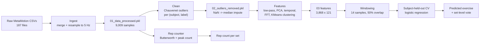
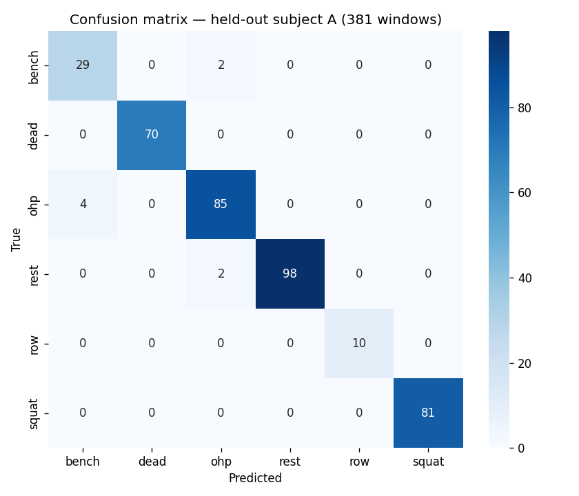
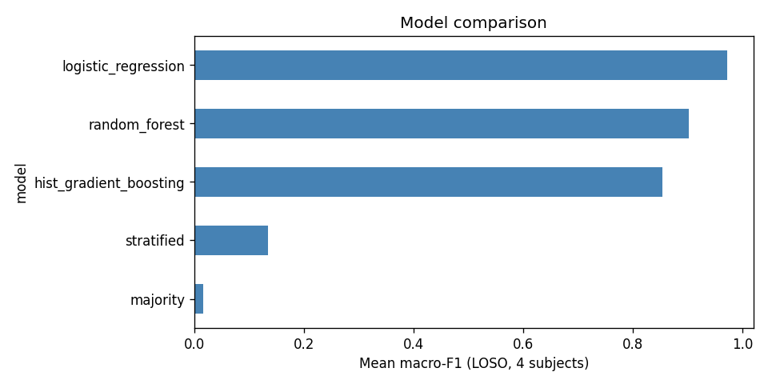

# Barbell Tracker

**Classify barbell exercises and count repetitions from wearable IMU data — with leakage-safe evaluation.**

[](https://www.python.org/)
[](#license)
[](#development)
[](https://github.com/imahrous13/Tracking-barbell-exercises-with-ml/actions)
[](https://github.com/imahrous13/Tracking-barbell-exercises-with-ml/commits/main)

A small, honest machine-learning project: take raw accelerometer + gyroscope streams from a MetaMotion wearable, and predict which of six exercises (bench, deadlift, overhead press, row, squat, rest) is being performed and how many reps were completed. The headline number is not the 99% you usually see in notebook projects — it is a **subject-held-out** 97.9% window accuracy and 100% set-level accuracy on a participant the model never saw during training, reported with the caveats that come with it.

## Why this exists

Most "recognize exercises from a smartwatch" demos train and test on shuffled windows from the same people, which leaks subject identity, sensor placement, and tempo into the test set. The model then looks brilliant and fails on the next person. This repo is a deliberate attempt to do it the boring, correct way:

- **Subject-held-out evaluation** (leave-one-subject-out) instead of random window splits.
- **Feature pipelines fit on training subjects only**, so PCA, KMeans and the scaler never see the test subject.
- **Set-level aggregation** on top of window predictions, because a single misclassified window should not flip a whole set.
- **Baselines included** (majority class, stratified random) so the ML result has something to beat.
- **An honest rep counter** with a measured MAE, not a "works on my data" screenshot.

## What the data looks like

Recordings from a **MetaMotion IMU** (accelerometer @ 12.5 Hz, gyroscope @ 25 Hz) worn during workouts. Five participants (A–E), 91 sets, six labels.

| Attribute | Value |
| --- | --- |
| Participants | 5 (A, B, C, D, E) |
| Sets | 91 |
| Raw files | 187 CSVs (94 accelerometer, 93 gyroscope) |
| Resampled signal | 5 Hz (200 ms), 9,009 samples |
| Labels | bench, dead, ohp, rest, row, squat |
| Categories | heavy / medium (lifts), sitting / standing (rest) |
| Window size | 14 samples (~2.8 s), 50% overlap → 3,868 windows |

Each filename encodes participant, exercise, load and RPE, e.g. `A-squat-heavy2-rpe8_MetaWear_..._Accelerometer_12.500Hz_1.4.4.csv`. The raw CSVs and the three intermediate pickles (`01/02/03_*.pkl`) are committed, so the whole pipeline runs without downloading anything.

<p align="center">
  
</p>

*Accelerometer (top) and gyroscope (bottom) for one squat set, participant A.*

## How the system works



| Stage | Module | Input | Output |
| --- | --- | --- | --- |
| 1. Ingest | `barbell.data.ingestion` | `data/raw/MetaMotion/*.csv` | `01_data_processed.pkl` |
| 2. Clean | `barbell.preprocessing.outliers` | processed pickle | imputed frame |
| 3. Features | `barbell.features.engineering` | cleaned frame | 121-column frame |
| 4. Window | `barbell.features.windowing` | featured frame | 3,868 windows |
| 5. Train/Eval | `barbell.models.training` | windows | metrics + model |
| 6. Reps | `barbell.models.reps` | processed frame | per-set rep counts |

### Feature engineering

All features are computed on the 5 Hz resampled signal, and the stateful transforms (PCA, KMeans, scaler) are **fit on training subjects only**:

- **Magnitude** of acceleration and angular velocity (`acc_r`, `gyr_r`).
- **Butterworth low-pass** (1.3 Hz, 5th order) on all six axes + magnitudes.
- **PCA** (3 components) on the six IMU axes, normalised by range.
- **Temporal abstraction**: rolling mean and std over a 5-sample window.
- **Frequency features**: per 14-sample window, FFT amplitudes, dominant frequency, spectral centroid, spectral entropy (PSE).
- **KMeans clustering** (5 clusters) on the acceleration axes, added as a categorical feature.
- **Set duration** in seconds.

That is 117 numeric inputs per window. I kept the original feature set rather than chasing a larger one: with 5 subjects, more features mostly buy overfitting.

### Modeling decisions

- **Window-level classifier**, aggregated to set level by majority vote. A 2.8 s window is short enough to be responsive and long enough to capture a rep.
- **Logistic regression** (standardised) ended up beating random forest and gradient boosting on macro-F1. On ~3,800 windows with ~120 correlated features, a well-regularised linear model generalises better across subjects than the trees, which overfit subject-specific tempo. This is the kind of result you only learn by actually running the comparison.
- **Class weights** are left at default: the six classes are roughly balanced in the window table (rest is the smallest at 513/3,868).
- **No deep model.** With 5 subjects and 91 sets, a 1D-CNN or transformer would overfit and add a dependency I cannot justify. Classical ML + engineered features is the defensible choice here and is what I would ship.

## Results

### Subject-held-out evaluation (the honest number)

Training on subjects B–E, testing on subject A, who is never seen during training, feature fitting, or tuning.

| Metric | Value |
| --- | ---: |
| Window accuracy | **97.9%** (373/381) |
| Balanced accuracy | 97.8% |
| Macro F1 | 0.975 |
| Weighted F1 | 0.979 |
| Set-level accuracy | **100%** (29/29 sets) |

Confusion matrix (rows = true, columns = predicted):

|  | bench | dead | ohp | rest | row | squat |
| --- | ---: | ---: | ---: | ---: | ---: | ---: |
| bench | 29 | 0 | 2 | 0 | 0 | 0 |
| dead | 0 | 70 | 0 | 0 | 0 | 0 |
| ohp | 4 | 0 | 85 | 0 | 0 | 0 |
| rest | 0 | 0 | 2 | 98 | 0 | 0 |
| row | 0 | 0 | 0 | 0 | 10 | 0 |
| squat | 0 | 0 | 0 | 0 | 0 | 81 |

The only confusions are bench ↔ overhead press, which is physically plausible (both are pressing movements with similar arm trajectories). Everything else is clean.

<p align="center">
  
</p>

### Leave-one-subject-out cross-validation

Macro F1 averaged over 4 held-out subjects (B, C, D, E), tuning subjects only — the held-out subject A is reserved for the final number above.

| Model | Accuracy | Balanced acc. | Macro F1 |
| --- | ---: | ---: | ---: |
| **Logistic regression** | **0.981** | **0.973** | **0.972** |
| Random forest | 0.974 | 0.957 | 0.902 |
| Hist. gradient boosting | 0.925 | 0.889 | 0.855 |
| Stratified random | 0.172 | 0.195 | 0.135 |
| Majority class | 0.049 | 0.092 | 0.017 |

<p align="center">
  
</p>

Two things to note. First, the random forest is competitive on accuracy but weaker on macro F1, which means it is worse on the minority classes (rest, row). Second, gradient boosting is the worst of the three — on this data size and feature dimensionality, boosting overfits. I kept all three in the comparison rather than deleting the losers, because the comparison is the point.

### Repetition counting

A separate, simpler problem: given one set's signal, count the reps. Approach: Butterworth low-pass filter on the acceleration magnitude (or gyroscope for rows), then count local maxima with a minimum distance. Ground truth is taken from the dataset's set structure (5 reps for heavy sets, 10 for medium).

| Exercise | Sets | MAE | Notes |
| --- | ---: | ---: | --- |
| row | 20 | 0.30 | best; rowing has a clean periodic signal |
| bench | 19 | 0.42 | |
| squat | 15 | 1.07 | |
| dead | 11 | 1.00 | |
| ohp | 20 | 1.80 | hardest; overhead press has a weaker periodic signature |
| **Overall** | **85** | **0.91** | exact-match accuracy 48% |

This is the weakest part of the project and I am not going to dress it up. Peak counting on a magnitude signal is a toy approach: it ignores exercise-specific kinematics, it has no learned model, and the thresholds are hand-tuned per exercise. An in-sample grid search over cutoff/distance lowers the mean MAE to ~0.60, which is the ceiling of this method. A real version would learn a rep boundary detector (or use the classifier's per-window confidence) and be evaluated against manually labelled rep timestamps, which this dataset does not provide. The counter is kept because it makes the demo tangible, and its limitations are documented rather than hidden.

## Installation

### Prerequisites

- Python 3.8+ (3.8.15 is what `environment.yml` pins).
- Conda (Miniconda/Anaconda) **or** a venv.
- No GPU, database, or external service. Raw data and intermediate pickles are committed.

### Conda (recommended)

```bash
git clone https://github.com/imahrous13/Tracking-barbell-exercises-with-ml.git
cd Tracking-barbell-exercises-with-ml
conda env create -f environment.yml
conda activate barbell-tracker
```

### pip + venv

```bash
python -m venv .venv
# Windows
.venv\Scripts\activate
# macOS / Linux
source .venv/bin/activate

pip install -e ".[dev,app]"
```

The package installs as `barbell`. After install, the `barbell` CLI is available.

## Usage

### Run the demo (fastest way to see it work)

```bash
streamlit run app/streamlit_app.py
```

Pick a participant and a set in the sidebar; the app shows the sensor traces, the predicted exercise, the counted reps, and per-window predictions.

### Reproduce the experiments

```bash
# 1. Ingest raw CSVs -> 01_data_processed.pkl
python -m barbell.cli build-data --config configs/default.yaml

# 2. Train + evaluate (LOSO CV + held-out subject A). Slow (~20 min).
python scripts/train.py

# 3. Evaluate rep counting
python scripts/eval_reps.py
```

`scripts/train.py` fits the feature pipeline per held-out subject, so nothing leaks across subjects. Outputs land in `reports/` (`cv_results.csv`, `cv_summary.csv`, `confusion_matrix.csv`, `metrics.json`, `per_set_predictions.csv`) and `models/model.joblib`.

### Use the inference API

```python
import joblib, pandas as pd
from barbell.inference.predict import predict_exercise, predict_reps

art = joblib.load("models/model.joblib")
df = pd.read_pickle("data/interim/01_data_processed.pkl")
frame = df[(df.participant == "A") & (df.set == 1)].copy().sort_index()

windows = predict_exercise(art["model"], art["feature_pipeline"], frame)
print("predicted exercise:", windows["predicted"].mode().iloc[0])
print("reps:", predict_reps(frame, windows["predicted"].mode().iloc[0]))
```

## Project structure

```
.
├── app/
│   └── streamlit_app.py          # interactive demo
├── configs/
│   └── default.yaml              # all tunable parameters
├── data/
│   ├── raw/MetaMotion/           # 187 raw CSVs
│   ├── interim/                  # 01/02/03 pickles (committed)
│   └── processed/                # final datasets (placeholder)
├── legacy/                       # original exploratory scripts (reference only)
├── models/
│   └── model.joblib              # serialized model + feature pipeline
├── reports/
│   ├── figures/                  # EDA + result plots
│   ├── cv_results.csv            # per-fold metrics
│   ├── cv_summary.csv            # model comparison
│   ├── confusion_matrix.csv
│   ├── metrics.json              # final numbers
│   ├── per_set_predictions.csv
│   └── rep_counts.csv
├── scripts/
│   ├── train.py                  # LOSO CV + final eval
│   └── eval_reps.py              # rep-counting evaluation
├── src/barbell/                  # the package
│   ├── data/                     # ingestion + validation
│   ├── preprocessing/            # outlier removal, imputation
│   ├── features/                 # engineering + windowing
│   ├── models/                   # training, baselines, reps
│   ├── cv/                       # subject-held-out splits
│   ├── inference/                # predict API
│   ├── utils/                    # config, logging
│   └── cli.py
├── tests/                        # pytest (9 tests)
├── .github/workflows/ci.yml      # ruff + pytest on push/PR
├── pyproject.toml
├── environment.yml
├── LICENSE
└── README.md
```

## Configuration

All parameters live in `configs/default.yaml` — resample rate, outlier method, filter cutoffs, window sizes, FFT window, KMeans clusters, held-out subject, random seed. No hardcoded paths in the new code; `make_dataset`/ingestion resolve the project root from the file location.

## Testing and CI

```bash
pip install -e ".[dev]"
ruff check src tests
pytest -q
```

9 tests cover data validation, feature engineering, windowing, CV splits, and rep counting. GitHub Actions runs ruff + pytest on Python 3.9 and 3.10 on every push and PR.

## Limitations (read these before quoting the numbers)

- **5 subjects.** All metrics are on a tiny population. The held-out result is encouraging but not evidence of generalisation to the general public.
- **Random-split numbers in the literature are higher and misleading.** The original version of this repo reported ~99.4% on a shuffled window split; that number included subject and temporal leakage. The numbers here are lower and more honest. If you quote this project, quote the subject-held-out ones.
- **Overlapping windows.** 50% overlap means adjacent windows share half their data; window-level accuracy slightly overstates independence. Set-level accuracy (100%) is the more robust headline.
- **Rep labels are assumed, not measured.** Ground truth reps are inferred from set category (heavy = 5, medium = 10). There are no hand-labelled rep timestamps, so the MAE is an approximation of an approximation.
- **No CI history / no released model card.** This is a portfolio project, not a product.
- **Python 3.8 pins** in `environment.yml` are old; the package declares `>=3.8,<3.12`.

## What this demonstrates

- **Time-series ML on wearable data**: resampling, filtering, windowing, FFT features, subject-safe splits.
- **Leakage awareness**: pipelines fit on train only, subject-held-out evaluation, set-level aggregation.
- **Model comparison with baselines**, including keeping the losers and explaining why.
- **Honest reporting**: caveats, failure modes, and a weak rep counter documented instead of hidden.
- **ML engineering**: packaged code (`src/barbell`), YAML config, CLI, tests, CI, logging, serialised model, inference API, Streamlit demo.
- **Communication**: a README that leads with the problem and the honest number.

## Acknowledgements

- Feature-engineering and classification modules in `legacy/` are adapted from the code accompanying **Machine Learning for the Quantified Self** by Mark Hoogendoorn and Burkhardt Funk (ML4QS). Original source headers credit updates by Dave Ebbelaar.
- Project layout follows the [Cookiecutter Data Science](https://drivendata.github.io/cookiecutter-data-science/) template.
- Recordings collected with a MetaMotion IMU; raw CSVs and processed pickles are included in `data/`.

## License

No `LICENSE` file is included, so no license is granted by default. If you plan to reuse or redistribute this code, please open an [issue](https://github.com/imahrous13/Tracking-barbell-exercises-with-ml/issues) to discuss licensing. The ML4QS-derived modules in `legacy/` retain their original attribution.